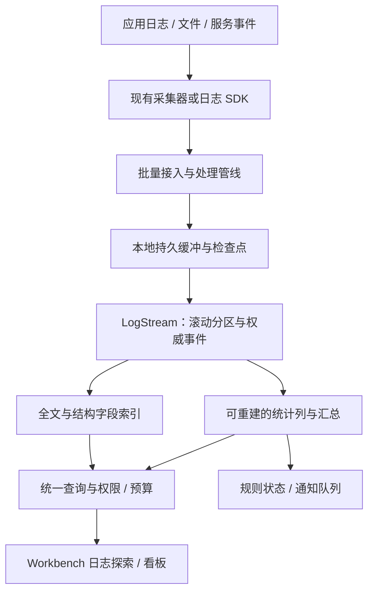

# ELK 能力引入 SonnetDB：单机可行性分析

分析日期：2026-10-16（Asia/Shanghai）。状态：研究与建议，不是实施计划获批或功能交付声明。

后续决策（2026-10-16）：用户已要求将本研究纳入路线图，现已形成 [M48 单机日志与事件分析详细规划](m48-single-node-log-event-analytics.md)和根 [ROADMAP](../../ROADMAP.md#milestone-48)。下文保留研究时的源码/范围快照；实施顺序以 M48 为准，产品能力仍未据此宣布交付。

本次阅读了根 HANDOFF、AGENTS、当前 ROADMAP、相关生产源码与 Elastic/OpenTelemetry 官方资料。分析时主树为 main，共享工作树中另有 Issue 验收任务和提交；中途读取 HEAD 为 `5d7bf064d4b5dd7c6cb705786d6268ce75a7d1fd`，不是本分析创建的提交，也不是所有读取的不可变快照。本次不运行构建、测试、性能或真实采集器验证，不修改生产代码，不创建 Issue、PR 或发布物。

可以把 ELK 的核心用户能力引入 SonnetDB，并且先做单机有合理价值。推荐目标是：日志与事件从接入、解析、可靠存储，到全文检索、时间统计、排障界面和规则告警形成闭环。功能迁移、Elasticsearch 协议兼容、源代码移植是三个不同范围，不能互相代替。

ELK 的常用价值并不以多节点为前提；但去掉分布式，只省掉分片分配、复制、选主和跨节点一致性等工作。磁盘索引、查询正确性、内存预算、持久确认、容量治理和交互体验仍然需要实现与验证。以下可行性及优先级属于基于源码和官方机制的工程判断，不是性能测量结果。

## 能力范围与取舍

Elastic 官方对 Stack 的划分是 Elasticsearch 存储/搜索/分析、Logstash 摄取/转换、Kibana 探索/可视化/管理；采集生态还包括 Agent、Beats 和 OpenTelemetry。不能把 ELK 简化为全文检索，也不必把整个现代 Elastic 产品组合纳入首版。[E1]

| 能力 | ELK 提供的用户价值 | SonnetDB 单机建议 |
| --- | --- | --- |
| 日志采集 | 应用、主机和服务的数据进入统一入口 | 优先对接现有采集器，先明确 JSON 批量合同；OTLP Logs 接收另做受限适配 |
| 解析与处理 | 结构化、字段变换、日期解析、清洗、富化、路由 | 自有小型声明式处理管线；优先 JSON、时间、rename/set/remove/convert、脱敏和失败分流；参考配置版本与模拟执行机制 [E4] |
| 可靠运输 | 排队、背压、重试、断点和失败处理 | 复用 M43 文件订阅/检查点/DLQ，补来源位点到目标提交的确认合同 |
| 检索 | 文本、结构字段、时间范围组合查找 | 复用已有全文和文档能力，优先修复候选过滤、排序、总数和分面的整体语义 |
| 聚合 | 每分钟错误量、服务 Top-N、延迟分位等 | 复用 SQL/时序及 M45；补日志命中集合上的聚合与受控列式访问 |
| 生命周期 | 滚动存储、保留、归档、回收 | 建立逻辑 LogStream 和物理时间/容量分区，复用 TTL 但补整分区回收与快照关系 |
| 探索界面 | 搜索、时间轴、字段统计、详情、保存查询 | 在 Workbench 增加日志探索视图，复用现有组件与权限上下文 |
| 仪表盘/告警 | 持久看板、关联过滤、阈值检测、通知 | 在探索闭环之后提供少量图表和规则；复用 M43/M45 状态与任务 |
| APM/关联 | 日志、指标、调用链关联排障 | 首先保存 trace_id/span_id 和服务身份，完整 Trace 接收、服务拓扑、采样另行实施 |
| 高级能力 | 语义检索、复杂检测、运营生态 | 语义日志检索可作为后续 SonnetDB 增量；SIEM/EDR、完整 Agent 管理与插件市场暂不纳入 |

## 当前能够复用的实际实现

下列“已有”只表示本次查阅到源码或既有证据记录，不能据此宣布端到端 ELK 场景通过。

| 基础 | 当前证据 | 需要补齐的边界 |
| --- | --- | --- |
| 文档存储 | `DocumentCollectionStore`、`docs/document-store.md`：JSON 文档、路径索引、TTL、change feed、派生索引修复 | 日志字段模板、数据流路由、批量持久确认和日志工作负载容量 |
| 全文引擎 | `FullText/Storage/PersistentFullTextIndex.cs`、`DocumentFullTextIndexStore.cs`：不可变段、manifest、BM25、多字段权重、精确/模糊和短语路径 | 大于内存的数据集、磁盘按需访问、预算化候选与合并 |
| 分析器 | `FullText/Tokenizers`、`Tokenization`：Unicode/CJK/中文、同义词等 | 日志路径、IP、异常类型、中英混合和版本升级的实际语料相关性 |
| typed 全文接口 | `SndbFullTextModels.cs`、`ManagementContractEndpoints.cs`：分页、过滤、facet、高亮和诊断 DTO/处理 | 全局结果语义、稳定时间排序、深分页一致性以及 Web 接线 |
| 有界过滤入口 | `DocumentCollectionStore.SearchFullTextFiltered`：允许 ID 集、posting 访问预算、取消，预算耗尽不返回部分命中 | typed 主入口没有采用这一执行路径；允许 ID 集本身的生成/内存也需预算 |
| 流处理 | `docs/streaming-subscription-contract.md`、`docs/m43-streaming-dlq-operations.md`、`docs/m43-streaming-task-catalog.md` | 已有文件持久订阅、窗口、任务和 DLQ，日志来源适配与目标确认不能假定已经贯通 |
| 聚合 | ROADMAP M45、现有 SQL/时序/窗口实现 | 不同模型的命中 ID 如何映射到聚合列；高基数、取消、spill 和恢复仍按原门禁推进 |
| 管理 UI | `FullTextSearchWorkbench.vue`、M47 WB-19/WB-28 记录 | 已有全文预览/分析器；typed 分页等完整旅程仍有边界，尚不能等同 Discover/Lens |
| 自身观测 | `docs/observability.md`、`OpenTelemetryBootstrap.cs` | 当前 Meter/Activity/OTLP exporter 主要观测 SonnetDB 自身；它不是外部业务日志/Trace 的 OTLP 接收后端 |

源码与当前十四能力索引一致：全文、Streaming、治理等仍各有 `partial` 边界。已有实现不重新包装成“从零建设”的任务。

## 优先解决的五个问题

### 1. typed 全文接口仍主要是候选窗口语义

`src/SonnetDB/Endpoints/Routes/ManagementContractEndpoints.cs` 的 typed 搜索路径目前：

1. 先取得最多 `min(10000, offset + pageSize + 1)` 个全文候选。
2. 有过滤时读取 `store.Scan(10000)`，对已截取的候选做过滤。
3. 对该候选集合排序、分页、计算 facets，并将 `ordered.Count` 写入 `TotalHits`。
4. `ApplyFullTextSort` 只明确处理 ID 和 score，没有按任意日志时间字段排序。
5. continuation token 携带 offset 和查询 fingerprint，没有绑定持久的查询快照。

嵌入式 `SndbFullTextClient.SearchEmbedded` 也采用相近流程。这些行为来自源码静态分析，本轮未运行复现实验。

直接影响：某服务的日志若排在首批相关性候选之外，先 Top-K 后过滤可能无法找到它；facet 和 TotalHits 不能代表所有匹配日志；持续写入时 offset 分页没有固定视图保障。不能仅修改 UI 文案后把它当作完整搜索统计。

建议新增/收敛执行合同：先把时间、服务、权限等条件与全文候选联合求交，再分别执行分页与聚合；总数明确为精确值、下界或未计算；facet 标明计算范围。复用已存在的 `SearchFullTextFiltered`，补预算化候选生成及统一主入口，不能只把一个大 HashSet 当作有界实现。

深分页采用稳定 `(event_time, event_id)` 排序和可过期读取视图，定义写入、删除、分区到期后的游标行为。Elastic 的 `search_after` 与 PIT 提供了可参考的机制，但不要求仿造其协议。[E3]

### 2. 持久化全文还需建设按需读取路径

`SegmentFile.Read` 会把段内文档字段、field lengths、posting dictionaries 和 positions 读入托管对象；`PersistentFullTextIndex.LoadSegments` 打开活动段。普通 `Search` 收集 scores、构造 hits、完整排序后截取 Top-K；`MergeSegments` 在索引锁内收集全部存活文档并重建单段。

这些事实说明内存、打开成本与合并峰值会随工作集增长；它们不能推出某个具体容量上限，但足以说明“文件已经持久化”不是“大数据集按需磁盘检索”的证明。

建议按实际瓶颈分片推进：批量写入与段大小策略、磁盘词典与 posting block、跳跃结构、有限缓存、Top-K 堆、预算化后台合并、读视图引用和取消。避免把每批写入一个段变成逐日志落盘一段。文件布局如需变化，必须遵守现有格式升级与迁移规则。

### 3. 统计需要与倒排索引不同的访问路径

Elastic 的倒排索引便于从词找文档；doc values 是在磁盘上按列组织字段值，用于排序和聚合。[E2] 借鉴这个分工比复制查询 DSL 更重要。

SonnetDB 已有时序/关系列式能力，但不会自动使文档全文命中上的聚合变成列式执行。当前 `DocumentCollectionStore.Aggregate` 仍把 `ScanRowsLocked(int.MaxValue)` 交给聚合执行器。

建议在一个明确权威数据源之上，为 event_time、service、level、duration 等建立可重建的列投影，并用稳定 event_id/行号连接文本命中与字段列。投影必须记录版本、源位点和可见水位；异步投影有延迟时需显式展示，不宣称文档、时序、全文跨模型原子提交。先证明受限字段集，再扩展字段类型。

### 4. 摄取的关键是故障恢复和字段合同

Logstash persistent queue 提供至少一次交付，持久性仍受 checkpoint、磁盘及配置影响；OpenTelemetry Collector 的持久发送队列也需要配置存储和重试策略，不能从“用了 Collector”推导不丢数据。[E5][E9]

建议区分三个时刻：已接收、已耐久提交、已可检索。确认必须绑定明确的持久点；超时但提交结果未知时，用稳定来源身份重试和核对。文件日志的身份应包含文件代际/偏移等，不能只用正文哈希把两条合法相同日志去掉。

HTTP 批量接入还要规定逐项失败、整批拒绝和重试策略。Logstash HTTP `json_batch` 发送 JSON 数组，不是 NDJSON；适配器必须匹配真实载荷与响应语义，普通 HTTP 成功不能代表每项已经建立索引。[E10]

字段模型建议明确区分：分词文本 message、精确 service/level/host、时间、数值、trace_id/span_id 与自定义 attributes。保留原始事件、缺失/NULL/空串和数值类型；限制字段数、深度、文本大小及解析耗时。高基数 trace_id、request_id、任意用户属性不应一律变成时序 TAG。嵌套对象数组不能随意扁平化后宣称同元素关联语义不变。

优先定义 ECS/OTel 的明确映射子集，标注规范版本与字段转换，而不是同时承诺完整兼容两套模型。ECS 的核心作用是跨来源事件字段归一化。[E8]

### 5. 需要日志产品流程与统一生命周期

`DashboardView.vue` 当前主要展示数据库、用户和授权信息；全文工作台当前分页切分返回窗口。它们可以复用，但用户还需要统一时间范围、时间柱状图、字段筛选、事件详情、前后文、保存查询和看板联动。Discover 官方定位正是从搜索/字段探索延伸到保存、共享与分析。[E7]

“查看前后文”还需来源序号或稳定时序身份；只按相同时间戳取临近行，不能保证同一文件或请求的顺序。规则告警需要 pending/firing/resolved、冷却、去重、静默、迟到事件政策和发送重试，不能把已有窗口计数视作完整告警产品。

建议 LogStream 是已有文档/全文/时序能力的逻辑组合，不新增第十种原生模型。复用已有文档 TTL 与时序 retention，新增的是滚动分区、只读阶段、归档/删除与查询视图的协调。Elastic data stream 的逻辑名称覆盖多个 backing indices、rollover 与保留机制可供参考。[E6]

迟到日志应明确按事件时间还是摄取时间分区，如何接受超出当前保留期或远未来的时间戳。删除原始日志时必须协调倒排、列投影、派生统计与读取视图；归档文件也不自动等于可直接查询的冷层。备份若依赖 Server 实例级 `.system/mq`，须独立覆盖该目录与对应位点；现有单库备份不能被提升为整个日志管线一致恢复。

## 建议的单机结构

图为建议方案。日志可以来自多台主机，存储与查询仍可集中在一个 SonnetDB 节点；“单机数据库”不要求所有日志都由本机产生。单机首版仍不提供节点故障后的自动接管，备份恢复与高可用须分开声明。

优先复用现有采集端，避免一开始建设所有文件轮转、多行异常、Windows Event Log、容器与设备协议采集器。Logstash 官方 HTTP output 可向通用 HTTP(S) 目标发送事件，因此可以评估“保留现有 Logstash，增加 SonnetDB 接收适配”的迁移路线。[E10] 这是待验证方案，不是已验证即插即用；已有 Elasticsearch output 的配置、模板、处理管线和 Kibana 看板不会因此自动迁移。

OTLP 支持放在 Server/独立适配层，明确 Logs、Metrics、Traces 的范围和编码，不把 SDK 的 exporter 当 receiver。Core 继续保持无第三方运行时依赖；生产 JSON 使用 source generation 或手写 reader/writer。解析规则使用声明式处理器与有界匹配，首版不引入任意 Ruby/Painless 式执行环境。

## 推进顺序与验收

建议作为现有里程碑上的候选纵向旅程讨论；下列阶段不是新建编号、排期或已批准的 ROADMAP 修改。

| 阶段 | 交付范围 | 必须回答的验收问题 | 对应既有方向 |
| --- | --- | --- | --- |
| 0：日志合同与基线 | 固定真实日志语料、字段/权限/排序/确认合同，复现现有候选窗口问题 | 首窗口之外的过滤命中能否找到；总数/facet 是否匹配全量参考；超过 10000 行如何处理 | M35/M36、V45-X05/X06 |
| 1：可靠接入与搜索 | JSON 批量适配、稳定身份、重放、联合过滤、正确时间排序和分页 | 断网、目标重启、提交后 ACK 丢失、磁盘满、多行/畸形记录能否明确恢复 | M43、M35/M36 |
| 2：容量和生命周期 | 按需磁盘索引、列投影、预算化聚合/合并、分区滚动与保留 | 数据量超过内存时，摄取/检索/统计/删除是否同时可控；迟到与视图过期是否明确 | M42/M45/M46、V45-X01/X02/X04 |
| 3：探索界面与告警 | 日志探索、时间轴、字段统计、保存查询、少量图表、阈值规则 | 同一过滤条件下 UI/API/导出/告警范围一致；重启和迟到不产生无界重发 | M47、M43/M45 |
| 4：按需求扩展 | OTLP 接收、Trace 关联、语义日志检索、业务/设备关联分析 | 真正改善排障；每项协议、模型质量及资源成本有独立证据 | M27/M35/M44、M36 |

阶段 1 可用小数据集跑通可演示流程；对外声明可承接生产日志负载，至少要完成适用的阶段 2 验收。不能因 UI 已展示搜索结果，就跳过原有固定硬件、恢复与容量门禁。

建议第一个用户旅程为：导入 .NET 应用结构化日志和一类 Web 访问日志，在最近 15 分钟筛选某服务的 timeout，查看按分钟错误数，再按 trace_id 打开相关记录和原始事件。字段统计与分页超过初始候选范围仍须正确。

需要验证的负载维度包括：持续/突发 EPS、事件大小分布、唯一词数、字段基数、保留时间、并发检索、冷缓存、合并及告警负载。记录硬件/commit/配置/语料、摄取确认 P95/P99、可搜索延迟、查询 P95/P99、峰值内存、落盘字节、写放大、重开时间及故障后的位点对账。性能对比时固定持久性和功能语义，不能用降低确认等级换吞吐。

容量必须由数据算起。仅作原始量示例，按平均 500 字节/条、十进制 GB 计算：

| 持续事件速率 | 一天原始事件量 | 七天原始事件量 |
| --- | --- | --- |
| 1000 条/秒 | 43.2 GB | 302.4 GB |
| 10000 条/秒 | 432 GB | 3024 GB |

公式为 `事件数/秒 × 平均字节/事件 × 86400 × 保留天数`。这里未计索引、WAL、缓冲、备份、合并临时空间及压缩效果；这些数字不是 SonnetDB 的吞吐或容量承诺。需要先给出目标硬件、每日量和保留期，才能冻结实施预算。

## “搬过来”的三种范围

| 方式 | 判断 |
| --- | --- |
| 借鉴能力与公开机制，用 SonnetDB 实现 | 推荐：选择明确的日志排障场景，保留自己的 SQL/API 与统一治理 |
| 接入 ELK 周边生态 | 推荐受限推进：先验证 Logstash HTTP 或采集器适配，再逐项决定 OTLP/某些 Elasticsearch API |
| 完整 Elasticsearch API / Kibana 直连兼容 | 单独的大项目：需要查询、mapping、聚合、分页、错误、版本及管理等兼容矩阵，首版不承诺 |
| 直接复制 Elasticsearch/Kibana 代码 | 不作为本方案路线。SonnetDB 当前 MIT、.NET/AOT 和零依赖约束需保持；Elastic 官方说明相关免费源码部分提供 AGPLv3/SSPL/ELv2 选项，默认发行物为 ELv2，须按文件与组件核对，不能改贴 MIT。[E11] |

建议优先批准范围讨论和阶段 0 的合同/复现切片。最大的研发投入应落在可靠摄取、检索与统计正确性、磁盘访问和生命周期上；已有 BM25、分词、窗口与 UI 基础继续复用。

## 本次源码证据入口

以下行号为查阅时定位，后续共享主树推进可能改变行号；路径与方法名为主要定位依据。

| 位置 | 用途 |
| --- | --- |
| `src/SonnetDB.Core/FullText/Storage/SegmentFile.cs:91`，`Read` | 段数据、posting 和 positions 的内存加载 |
| `src/SonnetDB.Core/FullText/Storage/PersistentFullTextIndex.cs:184`，`Search` | 候选计分、完整 hits 排序后截取 |
| 同文件 `:342`，`MergeSegments`；`:403`，`LoadSegments` | 全存活文档合并、活动段加载 |
| `src/SonnetDB/Endpoints/Routes/ManagementContractEndpoints.cs:752` | typed 候选窗口、过滤、分面、TotalHits |
| 同文件 `:1010`，`BuildFullTextFingerprint`；`:1027`，`ApplyFullTextSort` | offset token 和 ID/score 排序 |
| `src/SonnetDB.Data/FullText/SndbFullTextClient.cs:353`，`SearchEmbedded` | 嵌入式对应路径 |
| `src/SonnetDB.Data/FullText/SndbFullTextModels.cs:15` | 已有分页/facet/highlight 合同 |
| `src/SonnetDB.Core/Documents/DocumentCollectionStore.cs:777`，`Aggregate` | 文档聚合的当前扫描入口 |
| 同文件 `:1142`，`SearchFullTextFiltered` | 已有允许 ID 集与 posting 预算入口 |
| `web/src/components/FullTextSearchWorkbench.vue:657` | 返回窗口内本地分页 |
| `src/SonnetDB/Hosting/OpenTelemetryBootstrap.cs:31` | OTLP exporter 配置 |
| `docs/design/m47-unified-management-workbench/validation-report.md:485` | WB-28 真实 Top-K 证据及 typed/预算边界 |
| `docs/audits/fourteen-capability-evidence-index.json` | 既有能力归属与 partial 状态 |

## 官方资料索引

资料均于本次会话读取。官方文档是动态页面，本分析仅采用下列已读取的机制，不主张某个精确产品版本是最新版本。未成功取得的页面不列为证据。

| 编号 | 官方页面 | 本文引用范围 |
| --- | --- | --- |
| E1 | https://www.elastic.co/docs/get-started/the-stack | Stack 组件及职责 |
| E2 | https://www.elastic.co/docs/reference/elasticsearch/mapping-reference/doc-values | 倒排与按列访问的分工 |
| E3 | https://www.elastic.co/docs/reference/elasticsearch/rest-apis/paginate-search-results | 深分页、search_after 和 PIT |
| E4 | https://www.elastic.co/docs/manage-data/ingest/transform-enrich/ingest-pipelines | 顺序处理器、配置版本与模拟执行 |
| E5 | https://www.elastic.co/docs/reference/logstash/persistent-queues | 至少一次、checkpoint、背压和失效边界 |
| E6 | https://www.elastic.co/docs/manage-data/data-store/data-streams | 逻辑数据流、backing indices、rollover 和保留 |
| E7 | https://www.elastic.co/docs/explore-analyze/discover | 搜索、字段探索、保存与展示 |
| E8 | https://www.elastic.co/docs/reference/ecs | 跨来源事件的公共字段约定 |
| E9 | https://opentelemetry.io/docs/collector/resiliency/ | Collector 队列、持久存储与重试边界 |
| E10 | https://www.elastic.co/docs/reference/logstash/plugins/plugins-outputs-http | 通用 HTTP 输出与 json_batch 载荷 |
| E11 | https://www.elastic.co/pricing/faq/licensing | Elasticsearch/Kibana 源码与发行物许可口径 |

本次研究已完成，实施与实际验证均未开始。若后续转为代码工作，先按现有里程碑冻结一个切片，并执行相应定向回归、AOT 和最终提交前完整 restore/Format Check。
