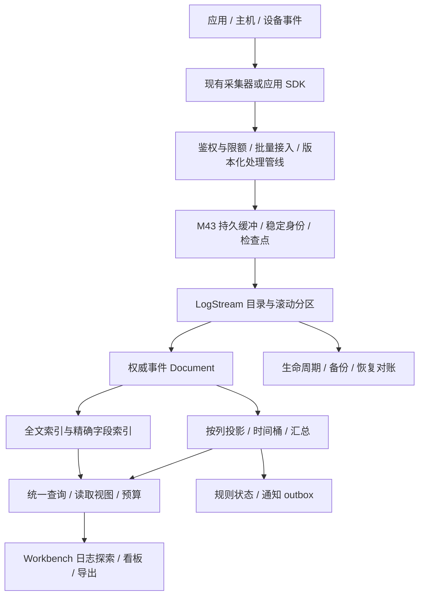

# M48 — 单机日志与事件分析

更新日期：2026-10-16（Asia/Shanghai）。状态：`📋 planned`。本文件是经用户要求纳入路线图的详细规划；产品实现、集成测试、性能与发布验收尚未开始。

对应根 [ROADMAP](../../ROADMAP.md#milestone-48)。研究依据与原始源码定位见 [ELK 单机能力分析](elk-single-node-capability-analysis-20261016.md)。`M48-L01`～`M48-L24` 是规划 ID，不代表已创建的 GitHub Issue/PR。一个 PR 只实现一个可独立审查的切片，不能把本文件整体作为单 PR 的实施范围。

## 1. 产品目标、版本归属和成功标准

M48 将 SonnetDB 已有文档、全文、时序、关系、KV、对象、MQ 与流处理能力组合成单机日志和事件分析流程：**采集 → 规范化 → 可靠写入 → 联合检索与统计 → 日志探索 → 规则告警 → 保留与恢复**。

首批面向 .NET 应用排障、Web 服务访问分析及工业/边缘设备事件。单机指一个 SonnetDB 存储与查询节点，可以接收多台机器的数据；不要求采集器和数据源与数据库同机。LogStream 是已有模型的逻辑组合，不增加第十种原生模型，也不改变十四能力索引的分类。

M48 作为独立增量里程碑进入路线图。R1 的必选范围为 L01～L20，L21～L24 为后续条件项。R1 的目标版本、日期、操作系统/架构和负载档位由 L01 冻结；本规划不把全部 M48 自动加入既有 4.5 正式版必选门槛，也不改写已发布 Workbench Preview 1 的范围。其适用的 M35/M36/M42/M43/M45/M46/M47 门禁必须保留。

R1 的核心成功标准：用户导入一类 .NET 结构化日志与一类 Web 访问日志后，能筛选最近十五分钟某服务的 timeout，看到同一过滤集合上的分钟错误数与级别分布，按 trace_id 查看关联日志及来源前后文。超过初始 Top-K、10000 条候选和内存工作集后，仍有正确结果或明确资源错误；故障重启、重复投递、分区滚动与到期删除有可对账结果。

| 范围 | R1 决策 | 后续边界 |
| --- | --- | --- |
| 数据源 | 应用 JSON 日志、Web 访问日志；.NET HTTP 示例和一个真实 Logstash HTTP 输出适配 | 更多文件/容器/设备采集器按实际需求逐项增加 |
| 部署 | 单写者、单 SonnetDB 节点；Web Admin + Server 为完整产品验收入口 | 嵌入式 SDK 验适用数据合同；Studio/VS Code 不从 Web PASS 推导 |
| 处理 | JSON、日期、字段操作、类型转换、脱敏、有限文本提取、路由和错误隔离 | 任意脚本执行、完整 Grok 词库/Ruby/Painless 插件兼容不纳入 |
| 检索 | 文本 + 时间 + 精确字段联合过滤，稳定时间排序、上下文、分页、明确统计范围 | Elasticsearch DSL/KQL/ES|QL 完整兼容不纳入 |
| 分析 | 时间直方图、terms Top-N、COUNT/SUM/MIN/MAX/AVG，受限精确/近似分位 | 任意 nested/join/pipeline aggregation 不自动承诺 |
| 产品流程 | 日志探索、保存查询、少量可组合看板、阈值告警与一个受控 Webhook 通道 | SIEM/EDR、完整 APM、Fleet/Agent 管理和插件市场不纳入 |
| 运维 | 背压、磁盘预算、分区保留、备份恢复、升级与回退、固定负载证据 | 自动 failover、复制/分片集群、跨节点事务另行规划 |
| 生态与 AI | 保留 trace_id/span_id 和服务身份，提供未来适配边界 | OTLP Logs、Trace 视图、语义检索和扩展迁移分别归 L21～L24 |

## 2. 复用基础、源码缺口与归属

本节事实来自前一轮源码阅读，不是新增运行结果。实施 L01 时必须重新绑定当时 commit 和真实入口，防止把期间已修复的代码重新派单。

| 已有基础 | 可复用范围 | M48 增量与原里程碑关系 |
| --- | --- | --- |
| Document/路径索引/TTL/change feed/派生索引修复 | 权威事件、稳定 ID、结构字段和恢复标记 | 日志字段模板、流目录和摄取幂等；底层文档容量仍归 M25/M36 |
| 持久全文/BM25/中文与多语言/短语和模糊检索 | 文本召回与 analyzer 合同 | 先解决 typed 候选窗口过滤/总数/facet，再做磁盘访问；复用 M35/M36/V45-X05 |
| `SearchFullTextFiltered` | 允许 ID 集、posting 预算和取消 | 接入统一日志查询；候选 ID 构建本身也要计费，不能用无界 HashSet 隐藏成本 |
| SQL/时序/持续计算与窗口 | 统计、时间桶、版本化状态的已有切片 | 日志命中与列投影绑定、延迟水位、告警计算；通用 state/retract/spill 属于 M45 |
| M43 持久订阅/检查点/DLQ/dispatcher/桥接 | 至少一次、任务和恢复 | 接入来源位点、批量确认、规则状态和通知 outbox；不再造第二套通用任务系统 |
| M41/M42/V45-X01/X02 | 执行预算、资源准入和有界结果 | 日志摄取/索引/聚合/导出/合并公平性与可观测成本 |
| M46 编码/读成本规划 | 底层编码与可复算成本 | 日志全文段和列投影的专属访问路径；格式变更仍逐组件审批与兼容验证 |
| M47 Workbench/typed SDK/身份与权限上下文 | 页面外壳、查询历史、撤权清理和结果平面 | 日志探索、保存查询与看板消费；三宿主验收分开 |
| Meter/Activity/OTLP exporter | SonnetDB 自身观测 | 摄取积压/索引延迟/告警指标；已有 exporter 不能作为接收外部遥测的证据 |

需要在 L01 优先验证的源码缺口包括：typed 全文先截取候选再过滤、TotalHits/facet 只计候选、ID/score 之外排序未实际实现、offset token 未绑定读取视图、全文段加载所有 posting/位置和字段、普通搜索全量收集后排序、合并收集全部存活文档、Document 聚合入口全量扫描。复现和整改分片归 L08～L11/L14；不是在规划中直接宣布缺陷已修复。

## 3. 逻辑架构与权威数据边界

权威数据是每个分区中的事件记录及其已提交身份；全文、列投影、汇总和告警输入均有明确的源位点/代际。数据接收、耐久提交、索引可见和告警计算使用不同状态与水位，不能由一个 HTTP 200 代替全部状态。

R1 优先把流目录、定义与权威事件放在同一数据库恢复域内。若复用实例级 `.system/mq` 或数据库外 spool，L07/L18 必须登记外部目录、恢复序列和位点；未证明可组合恢复前不能宣称单库备份覆盖全部日志链路。跨模型发布用版本、检查点和恢复对账管理，不新增九模型原子事务承诺。

## 4. 数据与查询合同

### 4.1 事件信封与字段

下列名称是设计中的语义字段，最终 API 拼写和 source-generated DTO 由 L02 冻结，尚未成为可调用接口。

| 字段 | 合同 |
| --- | --- |
| event_id | 稳定事件身份；命名空间包含数据库/流/来源代际。相同身份不同载荷返回冲突，不能静默 last-write-wins |
| source_id / source_generation / source_sequence | 区分同路径文件轮转、应用重启和来源重置；来源可提供 offset 或稳定递增序号，没有来源顺序时不声称前后文严格有序 |
| event_time / observed_time / ingested_time | 分别记录事件发生、采集观察与服务接收时间；查询明确选用哪个字段，缺失和解析失败不默默替换为当前时间 |
| time_precision / original_time | 冻结 UTC 整数时间单位、范围和输入时区；保留源精度与原文本。不得经过 Double，超出支持精度默认拒绝或走显式有记录的转换策略 |
| service / environment / host / level / dataset | 精确字段，允许受控归一化但保留原值；与全文 message 分离 |
| message / event.original | message 可分词；原始内容和其保留策略明确。脱敏后的普通事件不自动保留未脱敏原文 |
| trace_id / span_id | 关联字段，按其值语义精确比较；没有 Trace 后端时只提供日志关联，不伪造调用链 |
| attributes | 有界自定义字段，保留缺失/NULL/空串、数组和整数精度；默认不把全部键提升为索引或时序 TAG |
| schema_version / pipeline_version / source_position | 解释本次转换和恢复来源，重放时使用明确的原版本或显式迁移任务 |

SQL 对象名继续遵守 #211；JSON 属性与日志字段值不能被 SQL 名称规则隐式折叠。`service.name` 的外部键和嵌套 JSON path 的映射必须显式定义，处理点号、转义和大小写冲突。未知字段采用版本化的保留/拒绝策略，不动态创建无限列。

索引策略按字段用途声明：message 使用分词全文；服务/级别/trace_id 使用精确索引；时间和数值使用范围访问及统计列；仅展示字段保留原值。对象数组的关联谓词如果不能保持同一元素语义，R1 明确拒绝，不能直接扁平化后执行。

### 4.2 LogStream 与分区

LogStream 是数据库内有稳定 ID、显示名、schema/template 版本、pipeline 绑定、权限和保留策略的逻辑资源。重命名保留 ID，删除和重建生成新代际；游标、规则和采集身份不能跨代际复用。

R1 默认按**摄取时间/容量**滚动物理分区，event_time 用于查询和统计，避免迟到事件写入已关闭分区。每个分区记录实际 event_time 最小/最大值及统计完整性；统计不足时不允许错误剪枝。事件时间分区和回写已关闭分区是后续独立设计，不默认支持。

滚动状态为 Active → Sealed → Retiring → Deleted，归档另有 ArchivePending/Archived 及校验结果。先持久发布新写分区，再切写入路由；崩溃恢复后只有一个有效写目标。保留按明确的摄取时间边界执行，事件时间过旧/远未来由摄取规则处理；不能将分区关闭时间悄悄当作原承诺的逐事件 TTL。

保留期采用半开时间范围与 UTC 基准；配置更改记录生效版本。过期标记、读视图租约、派生索引删除与物理回收分层，容量紧急回收也不能删除仍被有效视图引用的数据。归档对象包含 manifest/checksum/源代际，R1 不承诺直接查询归档文件。

### 4.3 写入、确认和幂等

R1 同时区分两种运输模式，使用不同能力声明和配置，不允许自动切换：

- **逐项模式**：应用 SDK 使用有界事件数组，每项包含稳定身份，返回 durable/duplicate/rejected/unknown 等明确定义的结果；客户端只重试规定为可重试或未知的项。
- **通用 HTTP 批次模式**：用于 Logstash `json_batch`。HTTP 成功表示整个批次的已接受项均已耐久接收，永久无效项已经按配置耐久隔离并计数；仅有请求级状态、没有逐项重试能力的采集器，不能把部分成功包装成成功。隔离未成功、磁盘满或无法决定提交结果时返回明确失败，依赖稳定身份重试去重。

逐项模式的 HTTP 外层成功仅表示返回有效收据；整个批次不因此具备原子性。批次请求体/解压后字节、事件数、单条大小、解析深度和时间均在分配前受限。持久接收可以是已经 fsync 的权威事件，也可以是已经 fsync 的可恢复输入日志，但必须在收据中区分；索引可见状态由独立状态接口/水位判断。

去重保留时长必须覆盖支持的重试/断连窗口，过期策略与数据保留协调。没有稳定来源身份的接入只能声明至少一次和可能重复；不使用正文哈希合并合法重复事件。来源位点不能先于目标持久决定推进，提交结果未知时进入对账状态，不无限重发并谎称 exactly-once。

### 4.4 处理管线

管线由有版本的顺序处理器组成，支持在样例事件上模拟、逐步查看输出/错误并发布不可变版本。首批处理器为 JSON 解析、显式时区日期解析、set/rename/remove、受控类型转换、level 映射、脱敏、条件路由、有限文本提取和显式 drop。字段碰撞、溢出、输入缺失及提取失败都有 reject/quarantine/keep-original 等受支持策略；安全相关脱敏失败不能继续发送原始数据。

`keep-original` 只在该来源明确允许保存原文且权限/保留已经声明时可用；DLQ 和模拟预览同样执行敏感字段政策。固定规则优先使用无回溯匹配/声明式解析；必须使用回溯时限制输入、超时和捕获数量，验证 Native AOT；首版不执行任意用户脚本。重放原事件默认使用原 pipeline/schema 版本，升级重处理生成新代际并记录来源，避免覆盖权威原事件。

### 4.5 联合检索、分页和统计

查询先绑定数据流、权限、时间语义和固定读取视图，再将精确/范围过滤与全文命中联合求交。没有关键词的“仅时间/字段浏览”是 R1 必选。空查询、全匹配、高频词、短语、模糊展开和中文词典升级都要有显式资源边界。

时间升降序使用 `(event_time, event_id)` 的稳定全序；多分区用有界归并。按相关性排序单独声明，不能将无支持的时间排序静默退回 score。游标包含查询/授权范围绑定、读取视图/代际、最后排序键和过期信息；更换查询、流或身份拒绝。撤权即时生效，不能因旧快照继续读数据。

R1 需要明确固定视图或显式 stale 失败，不接受“token 是 offset + fingerprint”即声称快照一致。读取视图有数量/时长/引用磁盘预算，过期后用户显式重开；持续刷新模式另行声明，不与固定分页混用。

总数采用 exact/lower-bound/not-computed 等明确关系，预算不足不能返回看似精确的候选数。terms facet 的来源是完整过滤集合，Top-N 返回截断/其它桶信息；分页只影响 hits，不改变统计集合。时间直方图 R1 固定 UTC 桶和 `[start,end)` 边界，空桶、缺失字段、多值计数、零分母和精确/近似分位分别冻结。

全文倒排与统计列按稳定事件身份/分区代际联接。异步派生查询返回输入/索引/聚合可见水位，要求精确同步点的查询在未追平时等待至预算或明确拒绝；不能混合不同代际得出“最新完整”统计。汇总保留源位点、pipeline/schema/计算版本、缺口标志与迟到修订政策。

### 4.6 告警、权限和产品交互

R1 告警只支持明确窗口内的阈值类规则，例如错误计数、比例和延迟分位。规则有版本及 Disabled/Pending/Firing/Resolved 状态、观察期、冷却、静默和恢复通知。窗口使用 event_time，水位/迟到由 M43/M45 合同驱动；输入落后、统计不完整或状态不可恢复时标为 Unknown/Degraded，不能当作零错误或自动恢复。

规则状态、最后计算位点和通知意图有同一可恢复决定。通知发送是至少一次，outbox 有稳定 notification_id，重试/回执/失败隔离可查；对方接收成功但回执丢失可能重复，不能承诺外部 Webhook exactly-once。源数据保留删除不自动撤销历史告警，用户显式删除/更正规则另有审计。

R1 复用现有身份和数据库权限边界，至少区分采集写入、查询读取和管理/重放操作。若当前权限无法实现流级隔离，使用独立数据库并明确声明，不能只在 UI 隐藏。服务端对 hits、facet、总数、上下文、导出、保存查询、规则执行、DLQ、原始日志和快照重新授权。保存查询和看板不持久化访问令牌；规则用可撤销的运行身份，禁用用户/撤权会阻断后续执行和通知。

Workbench 复用当前连接/数据库/权限上下文，身份变化清除日志载荷、统计、下载与草稿。页面需显示时间范围、固定/实时视图、索引延迟、统计完整性和资源错误；默认当前页导出与有界全查询导出分别命名。首版图表限定时间趋势、数值卡片、terms 表/柱状图与保存查询，避免先建设通用可视化编辑器。

Webhook 仅支持经管理配置的目标和凭据引用，处理超时、大小限制、重试、证书及出口策略；日志内容不自动发送给任意 URL 或 AI provider。此处是产品功能合同，不要求本规划阶段配置或发送通知。

## 5. 工作包与交付物

以下每项初始状态均为 `📋 planned`。P0 是基础合同与关键路径，P1 是 R1 必须完成的深化，P2 是条件候选；P1 不等于可跳过。

| ID | 优先级/范围 | 交付物 | 前置依赖 |
| --- | --- | --- | --- |
| M48-L01 | P0 / R1 | 范围、真实语料、源码差距复现、负载/发布 profile 和证据清单 | 原研究、M35/M36/M42/V45-X06 |
| M48-L02 | P0 / R1 | 事件信封、字段映射、时间/精度/名称/类型与来源身份合同 | L01 |
| M48-L03 | P0 / R1 | LogStream 目录、模板版本、分区路由与原子滚动 | L02、现有 Document/catalog |
| M48-L04 | P0 / R1 | 批量 API、逐项/批次确认、稳定幂等和未知提交核对 | L02/L03、现有持久写入 |
| M48-L05 | P0 / R1 | 版本化处理器、模拟、错误/脱敏/重处理策略 | L02/L04 |
| M48-L06 | P0 / R1 | .NET 接入示例与真实 Logstash HTTP/json_batch 适配 | L04/L05 |
| M48-L07 | P0 / R1 | M43 spool/ACK/重投/背压/DLQ 的日志集成 | L03/L04、M43 |
| M48-L08 | P0 / R1 | 统一文本/时间/字段/权限过滤与完整性语义 | L02/L03、现有 filtered search |
| M48-L09 | P0 / R1 | 全文磁盘按需读取、批量段、缓存与有界合并 | L01/L08、M35/M42/M46 |
| M48-L10 | P0 / R1 | 固定读取视图、稳定排序/游标、上下文和有界导出 | L03/L08/L09、V45-X01 |
| M48-L11 | P1 / R1 | facet/时间直方图/统计列与精确、近似聚合 | L08/L09/L10、M45 |
| M48-L12 | P1 / R1 | 保留、封存、删除、归档与读视图协调 | L03/L07/L09/L10 |
| M48-L13 | P0 / R1 | 摄取/读取/管理权限、隔离、审计与脱敏边界 | L02；贯穿 L03～L20 |
| M48-L14 | P0 / R1 | 全链路预算、公平调度、取消与日志管线观测 | L01；贯穿 L04～L20，M42 |
| M48-L15 | P1 / R1 | Web 日志探索、时间轴、字段筛选与详情/上下文 | L08/L10/L11/L13/L14、M47 |
| M48-L16 | P1 / R1 | 保存查询、轻量看板、共享/导出与定义恢复 | L10/L11/L13/L15 |
| M48-L17 | P1 / R1 | 阈值规则、持久状态、静默/恢复通知与 Webhook outbox | L07/L11/L13/L14、M43/M45 |
| M48-L18 | P0 / R1 | 备份/恢复/强杀/磁盘故障/升级回退与位点对账 | L03～L14/L17、V45-X04 |
| M48-L19 | P1 / R1 | typed SDK/CLI/能力发现、接入迁移与运维说明 | L04/L08/L10/L12/L13/L18 |
| M48-L20 | P0 / R1 | 固定硬件/长稳/跨端/原生候选验证与发布收口 | L01～L19、原发布 policy |
| M48-L21 | P2 / 条件 | OTLP Logs 受限接收、Collector 实测与字段/精度映射 | R1、明确 OTLP profile |
| M48-L22 | P2 / 条件 | 真实 Trace 接收/查询及日志—Trace 关联视图 | L21、独立 Trace 合同 |
| M48-L23 | P2 / 条件 | 语义日志检索、相似异常与设备/业务关联分析 | R1、M27/M35/M44、真实质量门禁 |
| M48-L24 | P2 / 条件 | 更多采集器/字段包及经证明必要的协议迁移子集 | R1、明确消费者需求与兼容矩阵 |

### 5.1 L01～L07：来源与耐久摄取

**L01 — 范围、语料与基线。** 交付固定数据集 manifest、schema/预期结果、基线脚本与差距报告、目标 profile 表；原始数据脱敏及许可来源可追踪。至少覆盖中英文/多行异常、合法重复内容、时区/乱序/迟到、缺失/NULL、超大记录、高基数和超过 10000 条的匹配集合。冻结事件速率、平均及尾部大小、并发查询、保留天数、目标机器、磁盘和持久性等级；没有真实数据或阈值则为 NOT_READY，不能开始宣称容量达标。

**L02 — 事件与字段。** 交付版本化 DTO/JSON context、字段注册和转换/拒绝矩阵。对事件时间精度、Int64 边界、类型冲突、点号/引号/大小写、数组相关性、来源代际与重复身份逐项测试；旧客户端遇到新必需字段/版本可明确拒绝。最终事件字段名和单位进入合同后，示例/客户端/UI 共用一份描述。

**L03 — 流目录与分区。** 交付 Create/Describe/Update/Seal/Rollover 等受限管理合同及恢复状态机；实现前先评审实际 API 名称和权限，不凭本文构造现成可调用命令。验证时间/大小触发滚动、并发写入、崩溃点、重命名/删除重建和模板换代；更新 schema 不修改已写事件的解释方式，统计不完整时禁止不安全剪枝。

**L04 — 批量接入与确认。** 交付两种运输模式的请求/响应/错误和幂等合同、压缩与配额限制。验收空批次、混合有效/无效、重复 ID 相同/不同载荷、请求超时、未知提交、写入后 ACK 丢失、磁盘满以及重试窗口到期。持久确认前后分别注入故障，验证已确认数据恢复与未确认数据可重试；不把内存入队当 durable。

**L05 — 处理管线。** 交付可保存的版本定义、模拟报告、发布/回滚、输入输出 schema 校验和失败策略。至少两套真实日志模板在相同原事件上有可复算输出；无界正则、字段/类型碰撞、脱敏失败、DLQ 敏感数据、配置并发更新和原版本重放均有用例。不重新实现 Logstash 所有插件。

**L06 — 首批采集器接入。** 交付一个 .NET 应用发送示例、固定版本 Logstash HTTP 输出配置、从真实进程读取的接收/失败收据。验证 JSON 数组与 NDJSON 区别、TLS/鉴权、并发乱序、429/503/永久错误、断网重连和整批重发。明确文件采集由外部采集器负责，文件轮转/多行解析的证据归相应采集器 profile；本项不承诺 Filebeat/Elastic Agent 直接使用原 Elasticsearch 输出配置。

**L07 — 持久缓冲、来源位点与 DLQ。** 交付日志适配到既有 M43 的定义/检查点/确认记录、恢复流程与运维入口。故障矩阵覆盖目标提交前后、源 ACK 前后、重复 delivery、保留窗口到期、满队列、暂停/恢复和人工重放。稳定身份跨 pipeline/分区迁移保持可解释；隔离成功前不推进来源位点，未知状态停在可观察的恢复交接点。

### 5.2 L08～L14：查询、容量与治理

**L08 — 联合检索。** 交付同一执行计划上的时间/结构字段/全文/权限过滤、无关键词浏览、支持能力发现与预算错误。用独立全扫描参考实现核命中集合；必须覆盖首批相关性候选外的过滤命中、空结果、全匹配和超过 10000 条。每个分面/计数/导出入口消费同一绑定语义，不能在应用端反复抓 Top-K 拼装“完整结果”。

**L09 — 磁盘全文路径。** 交付批量段策略、按需词典/posting block/位置读取、有限缓存、Top-K 收集和增量合并。冷启动、读放大、缓存清空、损坏块、取消、磁盘满和前台/后台竞争有证据；数据集大于分配内存仍可完成受支持查询或明确拒绝。布局修改按格式版本、旧 reader/writer、迁移/回退与校验规则执行，不能以去掉 fsync 提升吞吐。

**L10 — 视图、排序、游标与上下文。** 交付多分区稳定时间/相关性排序、可过期固定视图、资源租约与流式有界导出。持续写入、同时间戳、分区滚动、删除、快照过期、撤权、断连、取消、查询变形和流重建不能静默漏读/重复。上下文按来源身份和序号查询，跨来源的时间邻近记录单独标注。导出记录 view ID、过滤、完整性和校验信息。

**L11 — 统计与列投影。** 交付统一过滤集合上的 count/facet/time histogram、数值统计和受限分位；定义列投影身份、版本、水位和重建流程。验证精确计数、missing/NULL、多值去重、Top-N/其它桶、UTC 边界、稀疏/偏态、分位误差、Int64 精度及高基数。流式派生与同一致性点离线重算对拍，未知/落后结果不能显示为精确总数；通用聚合能力归 M45 实现并复用。

**L12 — 生命周期。** 交付保留策略、封存/删除/归档任务、最小剩余磁盘及过期视图协调。验证迟到/未来时间、保留期缩短、进行中的读取/导出/重建、删除中崩溃、归档校验失败和重开恢复。原事件、全文、列投影和派生任务引用不产生“幽灵命中”；历史汇总是否保留按独立策略声明。

**L13 — 权限、隔离和审计。** 交付现有权限到日志操作的映射、认证/撤权矩阵及敏感字段政策。至少用两个数据库、写入专用/只读/管理身份，通过真实 Server 验证 hits/facet/总数/上下文/导出/规则/DLQ 的一致隔离；模拟 UI 只读不能作为权限证明。日志、异常、审计、URL 和保存定义不泄漏 token 或受限事件正文。

**L14 — 总预算与观测。** 交付从请求解析、spool、候选 ID、posting、排序/聚合状态到响应/导出队列的行/字节/时间/磁盘/并发预算及费用归属。后台合并、重建、保留和通知不能饿死前台；取消/超时释放租约，峰值计入解码和序列化临时对象。指标覆盖接收/耐久/拒绝/重复、spool bytes/oldest age、可搜索延迟、posting visits、扫描字节、聚合 state、视图磁盘保留、DLQ 和告警延迟；标签只使用有限维度。

### 5.3 L15～L20：完整产品旅程与发行

**L15 — 日志探索。** 交付 Web 页面与真实端到端用例：选择流/时间、关键词与字段筛选、时间轴、列管理、详情、原文权限、来源上下文、固定分页和显式刷新。权限/连接变化、迟返响应、部分统计、资源拒绝、超时与视图过期均有可理解状态。页内分页不能冒充 Server 全结果分页；页面必须调用 L08～L11 的真实入口。

**L16 — 保存查询与看板。** 交付版本化保存定义、轻量图表、相对/绝对时间、过滤联动、共享权限和导出。定义保存于明确恢复域，导入时校验流/字段/权限/版本；资源删除或 schema 变化时标为失效，不能静默展示其它库的数据。验证重启/恢复、撤权、多面板并发预算、旧定义升级和有限结果下载。

**L17 — 规则告警。** 交付阈值规则编辑/模拟、持久状态、运行身份、窗口水位、静默/恢复通知和一个 Webhook 通道。验证反复越阈、零分母、输入中断、迟到、重复事件、规则升级、暂停恢复、计算后崩溃和发送后回执丢失。规则结果与同视图离线计算相同，通知次数按已声明至少一次与稳定身份核对，不伪称绝不重复。

**L18 — 故障、恢复与升级。** 交付备份清单、一致性点、恢复顺序、不可恢复状态诊断及升级/回退说明。清单包含流/分区/schema/pipeline、权威事件、幂等与源位点、外部 spool/MQ、派生代际、保存查询和规则/outbox；凭据作为外部引用处理。强制终止、截断/校验失败、磁盘只读/满、恢复到新目录和不兼容版本分别验收；只把实测故障模型写入保证，不从 kill 测试推断掉电。

**L19 — SDK、CLI 与迁移说明。** 交付 source-generated typed client、能力/版本发现、有限导入/查询/状态/管理命令与接入指南。embedded/REST/适用 Frame 分别列支持矩阵，不为凑一致性凭空新增帧服务。示例必须以当前包真实运行；从已有日志文件/JSON 和 Logstash 配置迁移时说明字段转换、无损范围、失败回执、重复窗口及对账，不声称 Kibana 看板自动迁移。

**L20 — 发布证据。** 交付同一候选的功能/权限/真实采集器/故障/容量/长稳/原生发布报告、支持矩阵、已知限制和操作手册。冻结 R1 对应版本/源码/依赖/产物哈希及实际安装首跑；所有必选项有证据才标完成。原发布 policy 的 CI/Format/AOT/适用 Parity 与其它门禁原级别保留；规划文档或单次小规模 benchmark 不能替代。

### 5.4 L21～L24：条件项

**L21 — OTLP Logs。** 只有实际 Collector 需求与 R1 稳定后进入实施。单独冻结 transport/encoding/compression、协议版本、partial success/retry、resource/scope/severity/body/attributes、精度和字段限制；用固定真实 Collector、持久发送队列和故障案例验证。不把支持 Logs 自动扩展为 Metrics/Traces。

**L22 — Trace。** 单独定义 span 身份、父子/links/events、时间/状态/采样/重复与迟到，设计按 trace_id 查询和瀑布图；真实接收后再宣布调用链能力。仅把日志相同 trace_id 聚在一起不计完整 Trace/APM，服务拓扑及采样平台另作切片。

**L23 — 语义与业务关联。** 复用 provider、持久摄取、Hybrid/RRF 和 SQL/图入口，提供相似异常、设备/业务维度关联与有证据的辅助解释。真实语料 relevance/误报/成本、ACL/删除同步/模型换代和无证据拒答独立验收；hash fallback、合成向量和关键词命中不计真实语义质量。

**L24 — 生态与兼容子集。** 以明确消费者驱动逐项接入更多采集器或 ECS 字段包；若有 Elasticsearch API 兼容需求，另冻请求/响应/错误/版本矩阵。完整 Kibana、Elastic Agent/Fleet、查询 DSL、插件及商业方案兼容不属于默认目标。复用外部代码前按组件/文件许可核对，不从客户端许可推断服务端许可。

## 6. 阶段依赖、演示与正式完成

| 阶段 | 工作包 | 可展示结果 | 退出条件 |
| --- | --- | --- | --- |
| G0 合同与证据起点 | L01/L02，L13/L14 合同 | 固定语料、差距复现、目标 profile | 数据/字段/确认/错误/权限/资源/性能门槛冻结；未校准项阻断后续达标声明 |
| G1 可靠摄取与基础检索 | L03～L08，L13/L14 的适用接线 | 小规模真实日志进入、搜索、重试和隔离 | 实际 SDK/Logstash、耐久确认和核心过滤通过；只可标受限 pilot，不能称 R1 完成 |
| G2 容量与生命周期 | L09～L12，完善 L13/L14，L18 基础恢复 | 大于内存工作集的搜索/统计与保留 | 候选集合正确、固定视图、明确统计、总预算、滚动/删除及恢复通过 |
| G3 排障产品闭环 | L15～L17/L19，完成 L18 | 日志探索、看板、规则和运维 | 两条真实日志旅程、真实权限/重启/通知故障/SDK 证据完整 |
| G4 R1 交付 | L20 | 明确版本和范围的可安装候选 | L01～L20 必选验收和原发布门禁全齐；实际分发/首跑核验后才称发布 |
| 后续候选 | L21～L24 | OTLP/Trace/AI/扩展生态 | 各自单独评审、冻结范围与证明收益，不作为已有 R1 的隐式承诺 |

L13/L14 贯穿全程，不能等 UI 完成后才补权限或预算。L18 的故障用例从 G1 开始建设，不在最后一次性补造；L20 维护证据目录与校验模板，但不能替没有运行的工作包填 PASS。共享底层文件按原归属串行集成，独立应用/UI 可以在冻结合同后分别推进。

## 7. 验收矩阵与证据结构

| 验收域 | 最低覆盖 | 合格证据 |
| --- | --- | --- |
| 查询正确性 | 候选窗口之外命中、超过 10000、纯过滤、短语/模糊、多分区、并列时间 | 同一权威数据/视图下独立参考集合对拍；精确集合/顺序/计数无未解释差异 |
| 字段/精度 | 缺失/NULL、Int64 极值、时区/精度、多值、点号/引号/大小写、超限 | schema 与转换矩阵、回读原值及明确错误 |
| 可靠摄取 | 重复/冲突、断网、ACK 丢失、未知提交、队列满、异常记录 | 来源身份—耐久输入—目标记录—检查点逐项对账 |
| 分页/视图 | 连续写入、滚动、删除、视图过期、撤权、取消、断连 | 无静默漏读/重复；stale/expired/permission/budget 错误可区分 |
| 聚合 | UTC 桶、Top-N、多值、迟到、落后水位、精确/近似分位、高基数 | exact 结果对拍；近似结果按冻结误差，输出范围/版本/水位可回读 |
| 生命周期 | 保留更改、归档失败、活跃视图、删除中崩溃 | 无幽灵结果/错误回收、磁盘实际释放和任务状态对账 |
| 权限 | 两库、写入/只读/管理、撤权、保存定义/规则/原文/DLQ | 真实 Server 和浏览器组合；不以 props/mock 替代服务端拒绝 |
| 资源 | 大于内存数据、冷读、热点词、字段高基数、后台竞争 | working set/heap/临时峰值/磁盘/文件句柄及 P95/P99；超预算明确拒绝并释放 |
| 恢复 | 正常重启、真实 kill、损坏、只读/满盘、备份还原、版本拒绝 | 原始命令/进程身份、文件哈希和事件/位点/规则对账；掉电另有证据 |
| 告警 | 迟到/重复、零分母、数据中断、规则换代、回执丢失 | 状态迁移/计算位点/notification_id/outbox 可核；未知不报恢复 |
| 客户端/发行 | .NET、真实 Logstash、REST、适用 embedded/Frame、Web 实物 | 固定版本消费者和产物来源；各协议/宿主分别报告 |

容量计算采用 `EPS × 平均事件字节 × 86400 × 保留天数`。例如 1000 EPS、500 字节/条约 43.2 GB/日、302.4 GB/七日；这只描述原始输入量，未包含压缩、索引、WAL/spool、视图保留、合并临时空间和备份，不能当作已达到的吞吐或容量。L01 另外冻结峰值/突发、长尾大小、索引选择率、并发与最小空闲空间。

| profile 字段 | 冻结要求 |
| --- | --- |
| 硬件/系统/文件系统 | 真实 CPU/内存/磁盘/架构、系统版本、限额；托管缩规模与固定目标机分开 |
| 数据和负载 | 语料哈希/来源、EPS 稳态与突发、大小分布、保留期、唯一词/字段基数、查询混合与并发 |
| 持久与可见性 | fsync/批次/ACK 模式、可搜索延迟、投影追平及允许恢复窗口 |
| 资源/SLO | 峰值内存/磁盘/队列、写入与查询 P95/P99、最坏拒绝行为、恢复时间；所有数值实现前实测校准并冻结 |
| 长稳 | R1 固定 profile 连续 168 小时；包含实际滚动/到期、摄取与查询竞争和恢复事件，不能用缩短运行外推 |
| 比较 | 若对比 Elasticsearch，固定同语义、同硬件/资源、数据/配置与持久性；不预填倍数收益 |

每份验收收据包含 task ID、源码完整 SHA、候选/组件版本、语料与配置哈希、硬件、命令、起止时间、退出码、实际计数、原始日志/TRX/trace、限制和失败记录。每个工作包分开记录实现、单元、真实服务、采集器、容量、恢复、长稳、AOT、发行状态。缺失为 NOT_RUN/NOT_READY，失败保留 FAIL；不能把文档状态改成 supported 代替证据。

大型原始产物保存在受控 artifacts，Git 只纳入可复算脚本、清单和脱敏报告；不提交 bin/obj/包或含真实敏感日志的语料。真实数据引用用可验证哈希和获得方式，不能将凭据写入示例、报告或 URL。

## 8. 升级、依赖和实施规则

Core 保持 Safe-only、零第三方运行时依赖、Nullable/警告即错误。JSON DTO 使用 source generation，动态属性用 `JsonElement` 或有界 reader/writer，不能回退反射序列化。协议库和采集器适配放在 Server/独立边界；新增依赖须说明必要性、许可和 AOT 路径。

实现先复用现有模型管理器、M43 调度/状态、M42 预算和 M47 客户端，不另建重复存储引擎或任务平台。任何新的目录、manifest、段、checkpoint、规则/看板定义都声明版本、CRC/完整性、原子发布与旧版本拒绝行为；如触及既有二进制布局，遵守根 AGENTS 的版本、CHANGELOG、迁移/拒绝铁律。

旧全文 API 的候选窗口行为不能静默扩大成新的资源无界操作。L08～L11 冻结修订或版本化合同，给旧客户端明确能力/错误；SDK、Server、CLI、Web 同步消费。回退使用升级前可验证副本，原写入屏障不可绕过；备份恢复与降级兼容分别验证。

每次代码/文档提交前仍在最终待提交工作树执行完整 `dotnet restore SonnetDB.slnx` 和 `dotnet format SonnetDB.slnx --verify-no-changes --no-restore --severity warn --exclude extensions/`。M48 的新增测试应验证用户合同、边界与故障恢复，不为复制实现细节增加无意义测试。

## 9. R1 完成定义与近期派单入口

R1 完成需要同时满足：L01～L20 的必选入口交付且实际消费；两类真实日志从接入到搜索/统计/看板/告警可复现；权限、预算、恢复、生命周期和版本兼容闭环；固定 profile 的容量/168 小时及适用 AOT 证据完整；同候选发行清单、安装首跑、已知限制和升级回退可核。缺任一必选项只报告相应阶段，不能称“ELK 替代完成”。

首个实施切片建议只做 **L01：固定合同、语料与现有查询差距复现**，随后 L02 与 L13/L14 的设计合同。该切片须输出实际复现证据和已批准的 R1 profile，不能顺手修改全文格式或上线采集服务。之后按 G1→G4 推进；L21～L24 保持条件候选。

本次纳入路线图仅完成规划文档，不创建外部 Issue、不启动长期采集、不发送 Webhook、不发布产品、不声明新的日志能力已支持。后续实现与公开发布仍按用户届时授权和仓库门禁执行。
